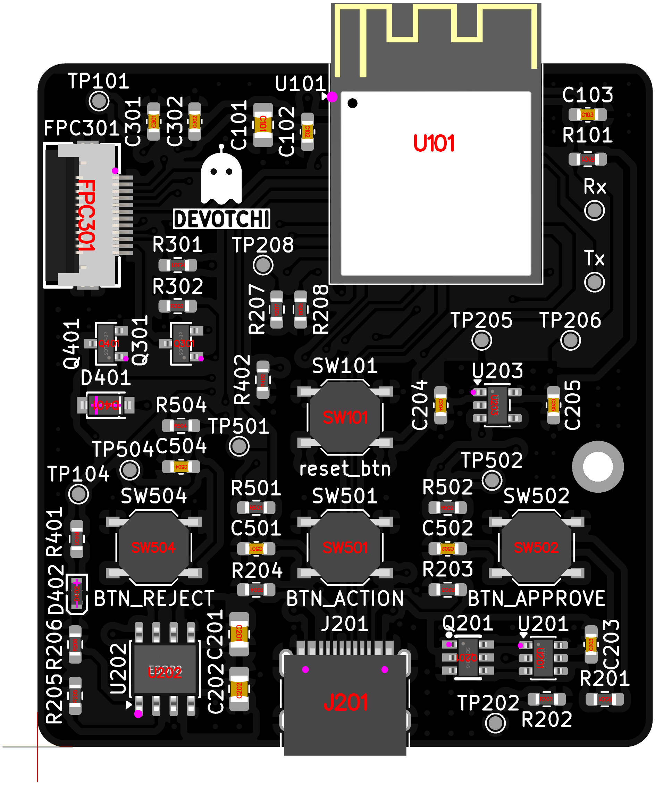

# Mini Companion 硬件工作区

本分支用于两台自用设备的设计和打样审查。打开 [当前硬件入口](hardware/ble-review/README.md) 即可找到 KiCad 工程、采购清单、外壳和验证记录。下面保存的是 Devotchi 原始项目说明，其 PCB 路径和量产资料属于上游设计。

---

# Devotchi

A Tamagotchi-style portable device that connects to AI coding agents (Claude Code, Cursor, etc.) via the Model Context Protocol (MCP). Your Devotchi shows what the agent is doing, handles approval requests via physical buttons, and its mood reflects the project's health.

Carry it in your pocket, clip it to your bag, or leave it on your desk — no need to stare at a terminal waiting for approval prompts. It vibrates, shows a nervous face, and waits for you to press a button.

## How it works

```
+------------------+          +---------------------+
|  User's PC       |          |  Server             |
|                  |  hooks   |                     |
|  Claude Code  ---|--------->|  Hook endpoints     |
|                  |          |  WebSocket router   |
|  MCP server   ---|--ws----->|  SQLite             |
|  (in client)     |          |                     |
+------------------+          +---------+-----------+
                                        |
                                        | WebSocket
                                        v
                              +---------------------+
                              |  Devotchi Device     |
                              |  (ESP32 + TFT LCD)   |
                              +---------------------+
```

1. **Claude Code hooks** automatically forward permission requests to the server via HTTP
2. The server sends them to your **Devotchi device** over WiFi (WebSocket)
3. You approve or reject directly on the device with physical buttons
4. The response goes back to Claude Code, which continues (or stops)
5. The **MCP server** lets the agent voluntarily send status updates, mood changes, and notifications

## Hardware

First prototype PCB, designed in KiCad and manufactured by JLCPCB.



- **MCU:** ESP32-S3-MINI-1 (dual-core 240MHz, WiFi + BLE, 4MB flash, 2MB PSRAM)
- **Display:** 2.0" IPS TFT LCD, 320x240, ST7789 driver, SPI interface
- **Input:** 3 tactile buttons (approve, reject, action) — any button press wakes from deep sleep
- **Power:** LiPo battery, USB-C charging (TP4056), DW01A protection, ME6211 3.3V LDO
- **Output:** Status LED, vibration motor

See [hardware/README.md](hardware/README.md) for full component details, pin assignments, and BOM.

## Project status

This is an active work-in-progress. The first prototype PCB has been designed and ordered. The software packages (server, client, web dashboard) are early prototypes being developed alongside the hardware.

## Repository structure

```
hardware/          KiCad schematics, PCB layout, BOM
firmware/          ESP32 firmware (C, ESP-IDF) — not yet started
packages/
  shared/          Protocol types and constants
  server/          WebSocket server + REST API + SQLite
  client/          CLI, MCP server, web dashboard
case/              3D-printable enclosure exploration
docs/              Architecture, protocol spec, datasheets
```

## Development

```bash
pnpm install
pnpm run build
pnpm run server    # Start server on :8080
pnpm run client    # Start client dashboard on :3456
```

## Documentation

- [Architecture](docs/architecture.md) — system overview, layers, data flow
- [Protocol](docs/protocol.md) — wire protocol specification
- [Hardware](hardware/README.md) — components, pin assignments, PCB design

## License

[MIT](LICENSE)
