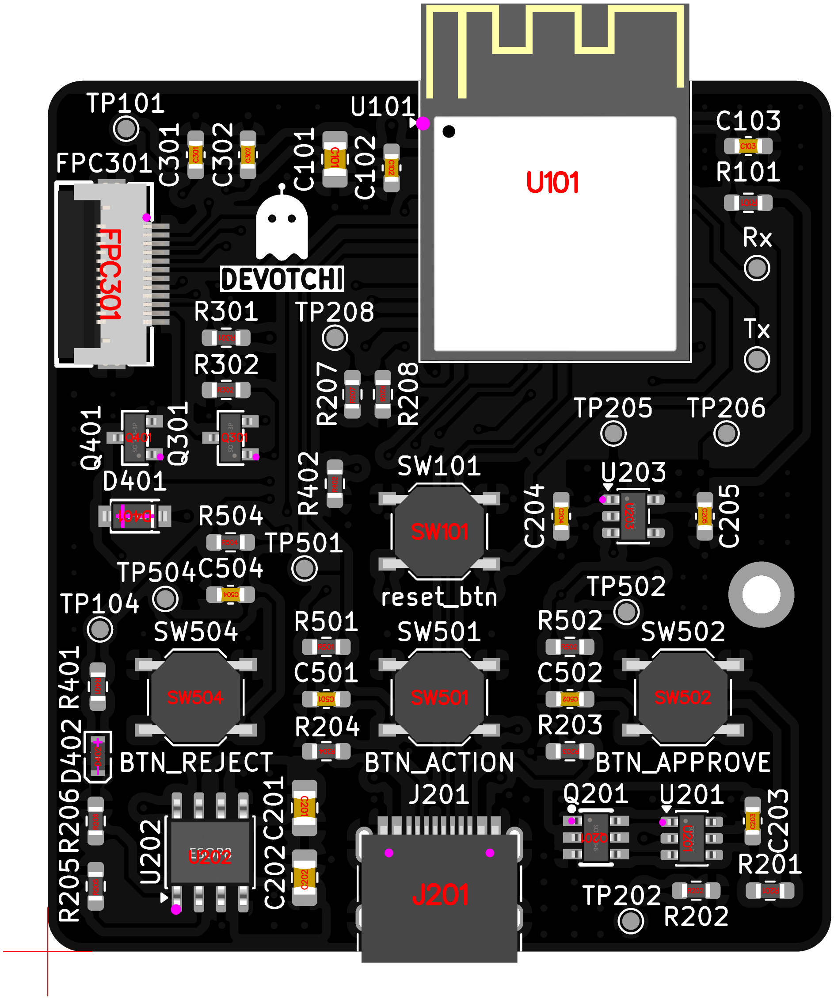
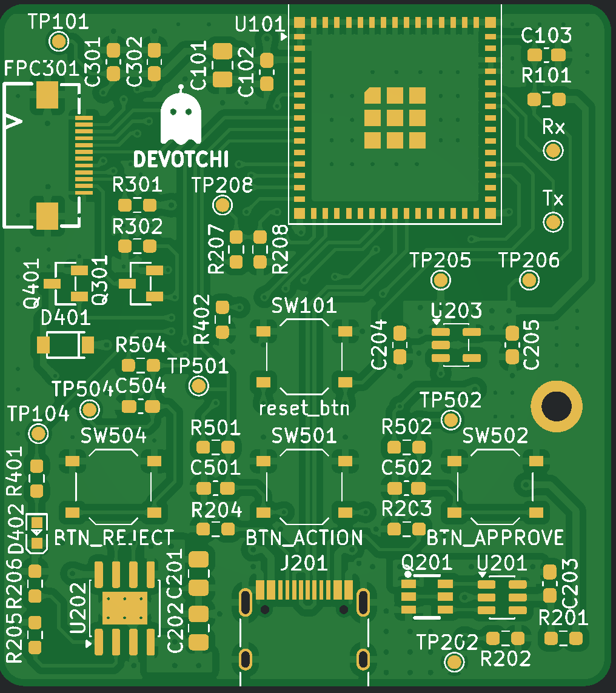
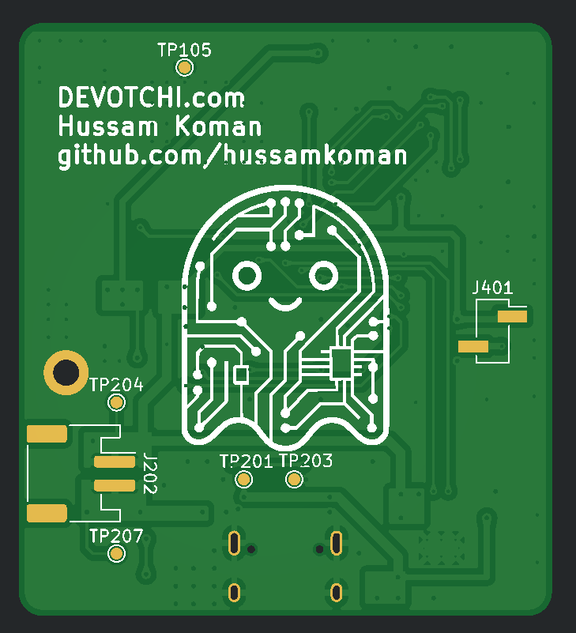

> 2026-11-19 · 此页保留早期设计背景。两台 BLE 样机从 [当前硬件入口](../hardware/ble-review/README.md) 进入。

# Hardware Design

## PCB

## Device Variants

### Portable WiFi+BLE (current)
- ESP32-S3-MINI-1 with integrated PCB antenna
- HS20HS072RX 2.0" color TFT LCD (ST7789, 320x240, IPS)
- LiPo battery, USB-C charging
- 3 buttons (approve, reject, action)
- Status LED, vibration motor
- Connects to server via WiFi, or to phone via BLE

### Portable Cellular (planned)
- Same form factor as WiFi+BLE version
- Additional cellular modem (MCU TBD — may use same ESP32-S3 + SIM module, or different MCU)
- SIM/eSIM support (provider TBD)
- Works standalone anywhere with cell coverage

### Desktop (planned)
- USB-powered (no battery needed)
- Potentially larger display
- Same ESP32-S3-MINI-1, connects via USB serial or WiFi

---

## Parts

See [purchase-list.md](purchase-list.md) for the complete BOM with LCSC part numbers and sourcing info.

### MCU: ESP32-S3-MINI-1-N4R2

| Spec | Value |
|---|---|
| Part number | ESP32-S3-MINI-1-N4R2 (4MB flash, 2MB PSRAM) |
| CPU | Dual-core Xtensa LX7 @ 240 MHz |
| SRAM | 512 KB + 2MB PSRAM |
| WiFi | 802.11 b/g/n, 2.4 GHz |
| Bluetooth | BLE 5.0 |
| Antenna | Integrated PCB antenna |
| Module dimensions | 15.4 x 20.5 x 2.4 mm |
| Operating voltage | 3.0 - 3.6V |

**Datasheets:** [Module](../docs/mcu/ESP32-S3-MINI-1_datasheet.pdf) | [SoC](../docs/mcu/ESP32-S3_SoC_datasheet.pdf)

**Why N4R2:** PSRAM needed for display framebuffers — 320x240 RGB565 = 150KB per frame, double buffering needs 300KB. Without PSRAM, internal 512KB SRAM can't fit framebuffers + WiFi stack + application.

### Display: HS20HS072RX 2.0" Color TFT LCD

| Spec | Value |
|---|---|
| Manufacturer | HS (Shenzhen Hansheng) |
| Part number | HS20HS072RX |
| LCSC | C5329582 |
| Driver IC | ST7789T3 |
| Size | 2.0 inches diagonal |
| Resolution | 320 x 240 pixels (QVGA) |
| Colors | 262K (RGB666) |
| Pixel pitch | 0.151 x 0.153 mm |
| Active area | 40.80 x 30.60 mm |
| Module size | 51.80 x 36.20 mm |
| Interface | SPI (4-wire) |
| Operating voltage | IOVCC 1.65-3.3V, VCI 2.4-3.3V |
| Backlight | 4 white LEDs in parallel, 80mA max |
| Backlight forward voltage | 3.0V typical (2.8-3.2V) |
| Sleep current | ~30 uA (SLPIN command) |
| Viewing angle | ALL directions (IPS) |
| Contrast ratio | 300:1 typical |
| Connector | 12-pin FPC, 0.5mm pitch |
| Connection type | COG + FPC |

**Datasheet:** [HS20HS072RX datasheet](../docs/display/HS20HS072RX_datasheet.pdf)

**Source:** [LCSC/JLCPCB C5329582](https://www.lcsc.com/product-detail/lcd-screen_hs-hs20hs072rx_C5329582.html) — $3.70 (1+), $2.49 (100+), 1687 in stock.

**Why this part:**
- Full RGB color — expressive Tamagotchi character (red angry, green happy, etc.)
- 320x240 resolution — excellent detail for pixel art and text
- IPS viewing angle — looks good from any direction (critical for handheld)
- Runs entirely on 3.3V — no boost converter needed (unlike OLED panels needing 12V VCC)
- ST7789 has first-class ESP-IDF support via built-in `esp_lcd` driver
- $2.49 at volume with 1600+ stock — cheap and available
- 12-pin FPC is simple to wire (vs 30-pin for OLED panels)
- Backlight can be PWM-dimmed via MOSFET for power saving

**FPC pinout:**

| Pin | Symbol | Description |
|---|---|---|
| 1 | GND | Power ground |
| 2 | CS | Chip select (active low) |
| 3 | RS (DC) | Data/command select |
| 4 | SCL | SPI clock |
| 5 | SDA | SPI data (MOSI) |
| 6 | RST | Reset (active low) |
| 7 | NC | No connect |
| 8 | IOVCC | I/O logic supply (3.3V) |
| 9 | VCC | Panel power supply (3.3V) |
| 10 | A | Backlight LED anode |
| 11 | K | Backlight LED cathode |
| 12 | GND | Power ground |

### Backlight Dimming Circuit

Backlight driven from +BATT (3.7-4.2V) through 22Ω resistor + AO3400A N-ch MOSFET, PWM-controlled by ESP32.

**Why +BATT instead of 3.3V:** LEDs have Vf = 3.0V. Only 0.3V headroom from 3.3V — poor regulation. +BATT gives 0.7-1.2V headroom.

**Circuit:** `+BATT → R (22Ω) → LED anode → LED cathode → MOSFET drain → GND`, gate driven by DISP_BL GPIO.

**Current at different battery voltages:**
- 4.2V (full): ~55mA | 3.7V (nominal): ~32mA | 3.4V (low): ~18mA

**Firmware:** PWM at 1kHz+. Sleep: SLPIN (0x10) + duty=0. Wake: duty>0 + SLPOUT (0x11), wait 120ms.

### Firmware Graphics Library

**Recommended: ESP-IDF native `esp_lcd` + LovyanGFX**

- `esp_lcd` provides the built-in ST7789 panel driver for SPI initialization
- LovyanGFX provides sprite-based graphics, text rendering, and animations
- LovyanGFX supports ESP-IDF natively (not Arduino-only)
- Supports DMA transfers for background rendering
- ST7789 sleep commands (SLPIN/SLPOUT) supported for power management
- Alternative: LVGL if more complex UI widgets are needed later

### Power Chain

USB-C → TP4056 (charger) → DW01A+FS8205A (protection) → ME6211 (3.3V LDO) → ESP32-S3 + display

**Datasheets:** [TP4056](../docs/power/TP4056_datasheet.pdf) | [DW01A](../docs/power/DW01A_datasheet.pdf) | [FS8205A](../docs/power/FS8205A_datasheet.pdf) | [ME6211](../docs/power/ME6211_datasheet.pdf)

**Key design notes:**
- TP4056 charge current set by R205 (3kΩ → ~330mA charge rate)
- DW01A+FS8205A: standard LiPo protection pair, back-to-back MOSFETs in battery ground path
- ME6211 LDO: 100mV dropout — at low battery (<3.4V) output sags below 3.3V, acceptable for MVP
- USB-C CC1/CC2 pull-downs: 5.1kΩ each for proper USB-C detection

### Buttons

3 tactile switches with hardware debounce (10kΩ pull-up + 100nF cap per button). Active low, pressed = GND. Any button press wakes from deep sleep.

| Button | Function |
|---|---|
| Approve | Accept approval/permission requests |
| Reject | Reject approval/permission requests |
| Action | Context-dependent: scroll, open menu, poke pet |

### Feedback

- **Debug LED** (green 0603) — GPIO direct drive through 150Ω resistor. Dev/debug only.
- **Vibration motor** (6mm coin, 3V) — AO3400A MOSFET driver + 1N5819W flyback diode. PWM-capable. Connected via solder pads.

---

## Pin Assignment

**Strapping pins to avoid:** GPIO0 (boot mode), GPIO3 (JTAG source, floating), GPIO45 (VDD_SPI), GPIO46 (boot mode). These are sampled at reset and should not have external loads that could affect their default state during boot.

| Function | ESP32-S3 GPIO | Notes |
|---|---|---|
| **SPI Display** | | |
| DISP_SCLK | GPIO 12 | SPI clock |
| DISP_MOSI | GPIO 11 | SPI data |
| DISP_CS | GPIO 10 | Chip select |
| DISP_DC | GPIO 9 | Data/command select |
| DISP_RST | GPIO 8 | Reset |
| DISP_BL | GPIO 13 | PWM via MOSFET to backlight cathode |
| **Buttons** | | |
| BTN_APPROVE | GPIO 4 | Pull-up, active low |
| BTN_REJECT | GPIO 5 | Pull-up, active low |
| BTN_ACTION | GPIO 6 | Pull-up, active low |
| **Feedback** | | |
| LED_PWM | GPIO 38 | PWM for brightness control |
| MOTOR_EN | GPIO 37 | Via N-channel MOSFET |
| **Power status** | | |
| PWR_CHRG | GPIO 18 | Low = charging |
| PWR_STDBY | GPIO 17 | Low = charge complete |
| BAT_ADC | GPIO 1 | Via voltage divider for battery level |
| **Future (unused, reserved)** | | |
| I2S BCLK | GPIO 15 | For microphone (voice commands) |
| I2S WS | GPIO 16 | For microphone |
| I2S DIN | GPIO 2 | For microphone (GPIO 17 used by PWR_STDBY) |

---

## Power Budget (estimated)

| State | ESP32-S3 | Display | Total | Battery life (500mAh) |
|---|---|---|---|---|
| **Active** (WiFi on, display on, backlight 100%) | ~80 mA | ~60 mA | ~140 mA | ~3.6 hours |
| **Idle** (WiFi connected, backlight 25%) | ~20 mA | ~15 mA | ~35 mA | ~14 hours |
| **Light sleep** (WiFi off, backlight off, LCD sleep) | ~2 mA | ~0.03 mA | ~2 mA | ~250 hours |
| **Deep sleep** (everything off) | ~8 uA | ~30 uA | ~38 uA | ~1.5 years |

Real-world usage will be a mix — display on for a few seconds when events arrive, then back to sleep. Expected practical battery life: **2-5 days** with typical AI coding session activity.

---

## Power Management Strategy

1. **Normal operation**: WiFi connected, display off. ESP32 in light sleep between events.
2. **Event arrives** (via WiFi): Wake up, turn on display, show status/approval, vibrate if needed.
3. **Approval request**: Display stays on with countdown timer until user responds or timeout.
4. **No activity for N minutes**: Enter deep sleep. Wake on any button press.
5. **Deep sleep**: Everything off. Battery lasts weeks/months.
6. **Display auto-off**: Display turns off after 30 seconds of no new events (configurable).

---

## PCB Design Notes

- **Single PCB** — power management and logic on one board
- Power section (TP4056, ME6211, USB-C, battery connector) on one side, logic section (ESP32, display connector, buttons) on the other
- Ground plane between sections
- ESP32-S3-MINI-1 antenna keepout zone respected (no copper/ground under antenna area)
- Display connects via 12-pin 0.5mm FPC cable (AFC01-S12FCA-00 connector)
- USB-C connector: 16-pin mid-mount type with D+/D- connected to ESP32-S3 USB OTG pins for firmware updates and serial communication
- Battery connector: JST-PH 2-pin SMD (standard for small LiPo, LCSC C7433648)
- Test points: 3.3V, +BATT, GND, UART TX/RX

---

## Enclosure

- 3D printed (material TBD: PLA, ABS, or PETG)
- Size determined after PCB layout and LiPo selection
- Rough estimate: ~50 x 40 x 20mm (similar to original Tamagotchi)
- Cutouts for: display window, 4 buttons, USB-C port, LED light pipe
- Optional clip or lanyard hole for portability
