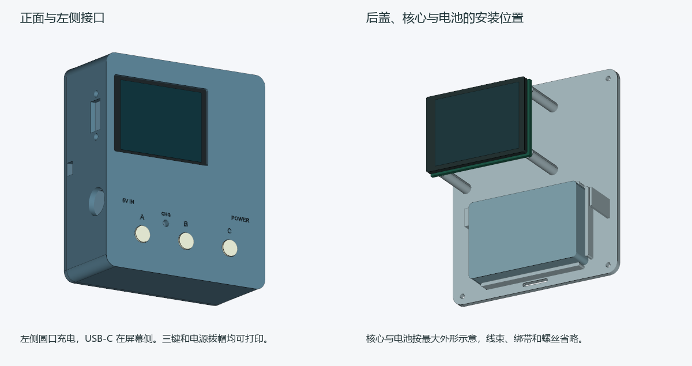

# 两台 A2 的外壳与代装

壳体为 80 × 94 × 33.4 mm，侧面拨帽比壳壁再突出约 1 mm。每台需要一只前壳、一只后盖、三个相同的按帽和一个电源拨帽。供方按 9000HE 树脂打印原尺寸件，清除支撑、通孔，试合后装机。两台共 12 件的尺寸估价为 74.00 元。[四款打印文件](stl/) · [在线计价记录](../verification/enclosure-web-quote.json)

| 每台用量 | 安装位置 | 装配尺寸与工序 |
|---|---|---|
| 4 颗 M2 × 25 机牙螺钉，头径不大于 4 mm | 后盖至微雪核心 | 从外侧沉台穿过四个套筒，旋入核心背面的 M2 铜柱。按标称尺寸旋入 2.10 mm，厂家标注孔深 2.5 mm。试装先核螺钉和铜柱实际长度，螺钉不得顶到玻璃或顶死。 |
| 4 颗 ST2 × 5 盘头自攻螺钉 | 载板至前壳 | 四角 PCB 通孔 Ø2.2 mm，顶部贴装面朝按键。树脂底孔 Ø1.66 mm，先用同材料试拧，同一孔重复装拆前检查开裂。 |
| 4 颗 ST2 × 10 盘头自攻螺钉 | 扣合后盖 | 前壳底孔深 8.5 mm，后盖通孔长 2.2 mm；此规格名义啮合 7.8 mm。自攻到贴合即可。 |
| 1 条约 10 mm 宽软绝缘束带、2 根小扎带或等效绝缘固定件 | 电池与线束 | 软带穿过后盖两道槽，覆盖电池平面；电池出线端朝左侧开口。探头及电池引线单独固定在后盖的线扣。RUN 线护套固定在前壳侧壁的线扣，从开口引出；保留弯曲和开盖余量。 |

1. 先在无电状态下测试两片机芯与线束的配合。微雪型号为无摄像头、无触摸的 SKU 30306。核对收到的硬件版本、原生 USB-C、BOOT/RESET、排针间距 2.54 mm、排针是否已焊、M2 安装点。需要焊排针或端接导线的工序交代装方。
2. 将三枚按帽由壳内送入导孔。侧拨帽从壳内送入右侧开口，使拨帽叉口套在 SW4 执行柄上。闭合后盖的挡片将拨帽限制在导槽内。装板前接好板上立式 PH 插头，导线向空隙弯出，避开开关、铜柱和核心天线。小板固定后，先测三个按键与拨动的两个稳定位置。
3. 后盖固定核心，再装保护电池。软包最大外形按 52.5 × 35 × 10.3 mm 计。将原厂绝缘的探头直接贴在电芯大面，3M 7413D 跨过探头固定在两侧。另做卸力，在两台热态试验中验贴合；覆盖胶带不叠在电芯与探头之间；成品线头、PCB 和螺钉均避开软包封边。绑带保持定位且不压出凹痕。完成电芯与探头端接后验极性，再接载板 J2。微雪的 BAT 插座及 VBAT 排针保持空置。
4. 先接核心排线，再收好 RUN 线。把圆口配套电源标为「5V 充电」。将原生 USB-C 插口旁的两个孔按到货核心的丝印标为 BOOT 和 RESET；用钝头绝缘工具确认两个方向均可触达。测量 SW4 两个挡位，标记 RUN / OFF，再闭壳。
5. 确认圆头完全插到底能触发硬件停机，拔插 USB-C 时力由插头护套承受。盖板不夹线，开盖能先断开电池与信号线。壳内通断、充电和蓝牙检查见[整机验收](../整机验收.md)。

数字校核使用微雪公开 STEP 的实际实体、壳、拨帽、载板外形和电池最大包络。四种 STL 均为单一闭合实体。空载按键标称预留 0.25 mm，电池到小板背面的名义间距 5.3 mm。已核拨帽两端位置、壳体、核心安装柱、屏活动区和载板定位。树脂变形、连接器完全插入、线束弯曲、实际按键手感，以及测温贴合和热延迟仍需两台试装。厂家 STEP 为公开配套模型，来料以实际版号和尺寸为准。[数字交叠检查](geometry-check.json) · [微雪机械图和三维模型](https://docs.waveshare.net/ESP32-S3-LCD-2/Resources-And-Documents/)
