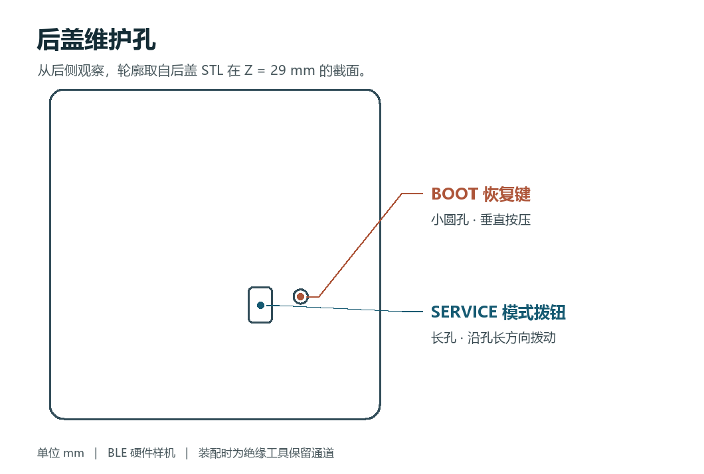

# 外壳与装配

每台前壳、后壳、三枚相同按钮、一个电源滑帽，共六件。四种 STL 可用于打印询价，外形 70 × 70 × 30 mm。后壳已为 USB 维护模式增加两个操作孔。[两台打印清单](design/PRINT_PARTS.csv) · [STL](stl/) · [模型程序](design/build.py) · [尺寸](design/parameters.json)。

| 从后面操作 | 壳坐标 X / Y（mm） | 操作空间 |
|---|---|---|
| 长孔 SERVICE | 44.65 / 24.2 | 5.0 × 7.5 mm；拨钮沿板 Y 方向移动。名义工具触达深度约 16.1 mm。 |
| 小圆孔 BOOT | 53.2 / 26.0 | Ø3.0 mm；按压方向垂直 PCB。名义触达深度约 20.1 mm。 |

两件均在电池右侧。在实际导出的 16 个 STEP 实体中，按工程高度包络和直达操作路径做求交，未见干涉；两处的余量、拨力、实际触感、照明和线束布置需试装。代装方应把电线固定在操作路径外。使用钝头绝缘塑料工具，断开线缆再拨模式。打印件已通过网格闭合和底面检查。[操作通道验证](service-access.json)。

**无线需要在壳内验证。** 按 BLE-A0 模组中心 (41.5, 22.5)、方向 0°、天线带与屏幕尺寸复核，屏幕在 XY 平面覆盖整个约 77.8 mm² 的天线带。模组最大本体包络到屏约 0.30 mm；实际天线到屏背金属距离仍待测。保留当前器件做两台样机，是以试样控制成本的选择。先在相同距离和朝向比较裸板、装屏、闭壳三种状态下的双机与手机发现/连接，再决定是否需要调整屏和天线位置。板上四层禁布区不能替代整机无线测试。[乐鑫模组布局指南](https://docs.espressif.com/projects/esp-hardware-design-guidelines/en/latest/esp32s3/pcb-layout-design.html#general-principles-of-pcb-layout-for-modules-positioning-a-module-on-a-base-board)。

BLE-A0 的探头接线焊尾到模组、按键尖端到开关名义间隙均约 0.10 mm。焊尾、排线、软包电池及探头固定由代装方控制，导线应绝缘并作应力释放。PCB 装入和后盖取下时实测焊尾余量、按键行程、USB 插头空间、无线表现和闭壳温升。
